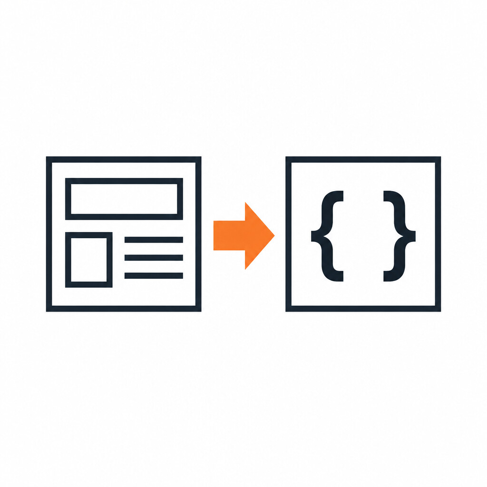
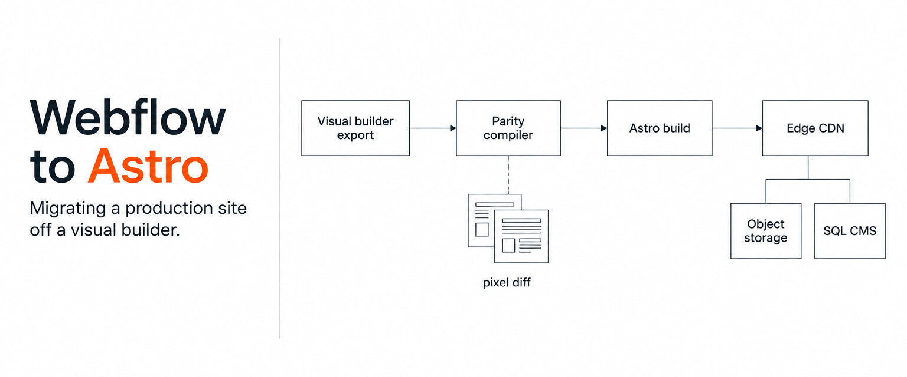
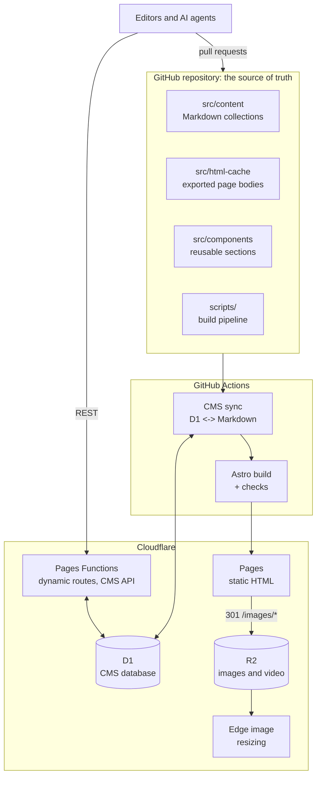

<p align="center">
  
</p>

<h1 align="center">Webflow to Astro</h1>

<p align="center">
  How I moved a production marketing site, with hundreds of pages and a live CMS, off Webflow and onto Astro, GitHub and Cloudflare, while keeping every page visually identical.
</p>

<p align="center">
  <a href="#the-problem">Problem</a> ·
  <a href="#architecture">Architecture</a> ·
  <a href="#how-the-migration-worked">Migration</a> ·
  <a href="#techniques-worth-reusing">Techniques</a> ·
  <a href="#results">Results</a>
</p>

<p align="center">
  
</p>

> **This is a case study, not the source.** The site belongs to a company I work with, so the code stays private and the company is not named. Everything below is written from scratch to explain the approach; no proprietary code, content or configuration is included.

## At a glance

| | |
|---|---|
| **What** | A B2B software company's marketing site: landing pages, product pages, a blog, a glossary, an integrations directory, case studies, customer stories, people and careers |
| **From** | Webflow (visual builder, hosted CMS, Webflow hosting) |
| **To** | Astro static build in a GitHub repo, deployed to Cloudflare Pages, with media on R2, a CMS on D1 and dynamic routes on Pages Functions |
| **Scale** | ~100 hand-designed page templates, ~750 CMS items across 16 collections, ~730 generated pages |
| **Timeline** | 5 months and ~860 commits, from the first export through launch and ongoing work on the new stack |
| **Team** | Me, with AI coding agents doing a lot of the typing |
| **Hard constraint** | Pixel parity. Visitors, sales and SEO must not notice the change |

## The problem

Webflow is great for designing a site and painful for running one at scale.

- **Everything is a click.** Bulk changes across 200 blog posts or 200 integration pages meant hours in the Designer or brittle API scripts.
- **No version control.** There was no diff, no review, no branch, no rollback beyond Webflow's coarse backups.
- **AI agents could not help.** Modern coding agents are good at editing a repo. They cannot drive a visual builder.
- **Cost and limits** on CMS items, locales, form submissions and hosting tiers grew with the site.

The obvious fix is "just export it". Webflow's code export gives you static HTML and CSS for the designed pages, but **no CMS content**, CMS-driven pages come out as empty templates, interactions depend on Webflow's runtime, forms post to Webflow, and every asset URL points at Webflow's CDN. There was no tool that turned a live Webflow site into a maintainable, deployable codebase with the CMS intact. So I built the pipeline myself.

## Architecture



**Git is the source of truth.** Every page and every CMS item is a file in the repo. The build makes no network calls.

**Static first, dynamic where it pays.** Almost everything is pre-rendered HTML on Cloudflare's CDN. Pages Functions handle the few routes that must reflect CMS edits immediately (blog, glossary, categories, integrations) by streaming the static template through `HTMLRewriter` and injecting content from D1.

**A CMS that agents can use.** A small REST API on Pages Functions exposes create, read, update and schema discovery for each collection, including the house writing guide and title framework, so an agent can ask "what fields does a blog post need and how should it be written?" before drafting one. A GitHub Actions step syncs D1 and the Markdown collections in both directions on every deploy.

**Media lives outside git.** Images and video are in R2. The HTML references plain `/images/...` paths, and two lines in `_redirects` send those to R2 with a permanent redirect.

**CI/CD.** Push to `main` deploys production; a staging branch deploys a preview. A monthly scheduled job refreshes "as of [Month Year]" titles and timestamps on evergreen posts.

## How the migration worked

### 1. Capture the real site, not the export

The export misses CMS content, so the starting point was the live site itself. Scrapers pulled every page's rendered HTML, every CMS item through the Webflow API and the published pages, and every asset referenced anywhere (including the ones only referenced from CSS and inline styles). CMS items were converted to Markdown with frontmatter in Astro content collections. Designed pages were stored as body HTML in an `html-cache/` directory and wrapped by Astro layouts that load Webflow's own CSS and re-initialize its interactions runtime, so animations behave exactly as before.

### 2. Compile CMS templates at build time

Webflow renders CMS lists and bindings (`w-dyn-list`, `w-dyn-bind-empty` and friends) at request time. A build-time "parity compiler" replaced that: it finds each dynamic list in a template, resolves it against the content collections, renders the items with the original markup and classes, and caps lists at the same item counts the live site shows so that both the layout and the SEO surface match.

### 3. Prove parity with a machine, not a glance

With hundreds of pages, "looks right" is not a test. I built a full-page visual regression scanner: Playwright renders each page on the old and new site at several widths, masks regions that legitimately differ (carousels, dates, embeds), and diffs them with `pixelmatch`. Failures were clustered by cause into a pattern database, which turned hundreds of page failures into a few dozen root causes: a wrapper nested twice, an empty-binding class that collapsed a section, a footer variant swapped, a font override missing. Each fix was re-verified across the full sitemap, and fixes that improved one template but regressed another were reverted.

### 4. Make it maintainable, then make it fast

Once parity held, the generated pages were refactored into reusable Astro section components (feature callouts, logo strips, testimonial sliders, CTA bands, forms) so new pages are composed rather than copied. Then the build pipeline took over the chores Webflow used to hide:

| Step | What it does |
|---|---|
| Form check | Fails the build if any raw Webflow form slipped through |
| Shared component healing | Rebuilds navigation dropdowns from the content collections |
| HTML performance pass | Lazy-loads below-the-fold images, pins third-party scripts, strips unused dependencies, points forms at the new handler with spam protection |
| Route generation | Writes `_routes.json` so only real dynamic paths invoke Functions |
| Sitemap and `llms.txt` | Generated from the build output |
| Asset verification | Fails the build if any referenced image is missing from storage |
| SEO audit | Errors across the whole site, warnings only for recently changed content |

### 5. Cut over

Production moved to Cloudflare Pages once the scanner was clean across the sitemap, with redirects for legacy URLs generated from the old site's routes.

## Techniques worth reusing

These are the patterns I would use again on any Webflow (or any visual-builder) exit. The code here is illustrative, written for this write-up.

**Serve media from object storage with two redirect lines.** No Worker invocation per image, browsers cache a 301 permanently, and local development still serves files from `public/`.

```
# public/_redirects
/images/*  https://assets.example.com/images/:splat  301
/videos/*  https://assets.example.com/videos/:splat  301
```

**Make the asset URL builder idempotent.** Several build passes rewrite asset URLs (render time, post-build HTML, CSS, and edge-rendered CMS pages). If any one of them prepends the origin twice you get `https://cdn.example.comhttps://...`. One function, safe to apply any number of times, ends that class of bug.

```js
export function assetUrl(value, base = process.env.PUBLIC_ASSET_BASE) {
  const src = typeof value === 'object' ? value?.src : value;   // CMS stores {"src": ...}
  if (!src || /^(https?:|data:)/.test(src) || src.startsWith(base)) return src;
  return base + (src.startsWith('/') ? src : '/' + src);
}
```

**Offload image processing to the edge.** Astro's default image pipeline runs `sharp` at build time and ran CI out of memory. A custom image service emits Cloudflare `/cdn-cgi/image/width=...,format=auto/` URLs instead, so resizing happens on first request and is cached at the edge.

**Never reuse an object key.** CDNs cache by key, so overwriting an image with the same name serves stale bytes for hours and looks like a failed upload. The `image:add` script converts to WebP, sanitizes the filename, emits a PNG twin for Open Graph images, and refuses to overwrite.

**Inject CMS content into static templates at the edge.**

```js
export async function onRequest({ env, params, next }) {
  const post = await env.DB.prepare('SELECT * FROM posts WHERE slug = ?').bind(params.slug).first();
  if (!post) return next();
  const page = await env.ASSETS.fetch(new URL('/blog/_template', 'https://x'));
  return new HTMLRewriter()
    .on('h1[data-field=title]', { element: (el) => el.setInnerContent(post.title) })
    .on('[data-field=body]',   { element: (el) => el.setInnerContent(post.html, { html: true }) })
    .transform(page);
}
```

**Keep sync pages small.** List endpoints that return full post bodies can exceed a Worker's CPU limit. Paging 25 at a time instead of 100 kept the sync reliable.

## Results

- **Parity:** the new site went live after the visual scanner passed across the sitemap, and the scanner kept running as a regression check afterwards.
- **Editing speed:** site-wide changes that took an afternoon in the Designer are a single commit, reviewed as a diff, and AI agents can now make them.
- **Publishing:** blog posts and glossary entries can be created through the CMS API and are live at the edge immediately, then committed back to git on the next deploy.
- **Ownership:** the site is plain HTML, CSS and JavaScript in a repo, hosted on infrastructure the company controls, with no vendor lock-in on content.

## What I learned

- **Exports are a starting point, not a migration.** The live site is the spec. Scrape what users actually see.
- **Measure parity.** A pixel-diff scanner with masking and failure clustering beat any amount of manual QA, and it kept catching regressions long after launch.
- **Fix classes of bugs, not pages.** Most of the 800+ commits were small, but the ones that mattered removed a whole category of failure: idempotent URLs, one asset helper instead of four copies, build-time checks that fail loudly.
- **Design for agents from day one.** A schema-discovery endpoint, a written style guide served by the API, and component docs in the repo made AI agents useful collaborators instead of a source of new bugs.

## Stack

Astro · Cloudflare Pages · Pages Functions · D1 · R2 · Cloudflare image resizing · GitHub Actions · Playwright · pixelmatch · Cheerio · Node.js · Python
